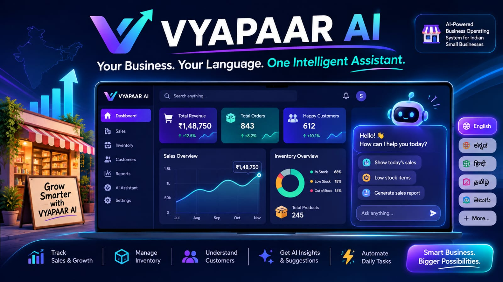
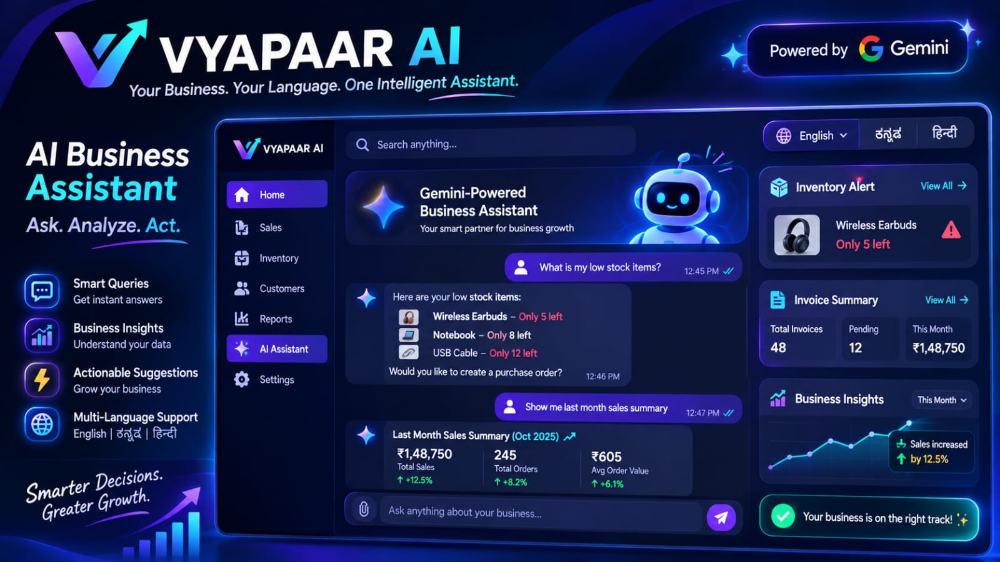
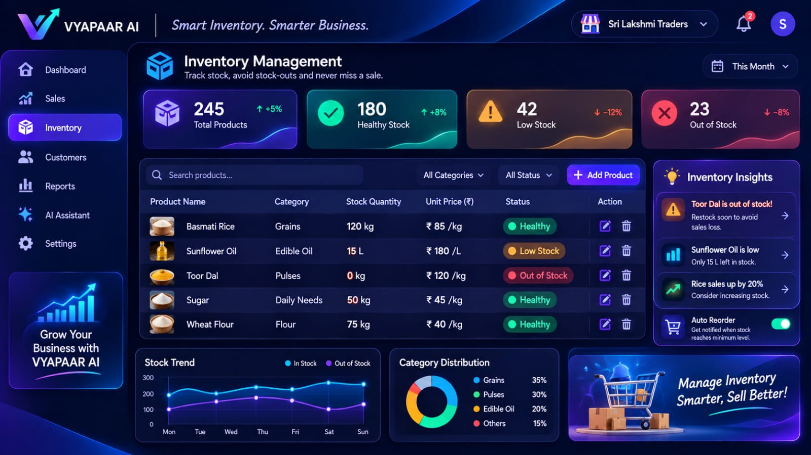
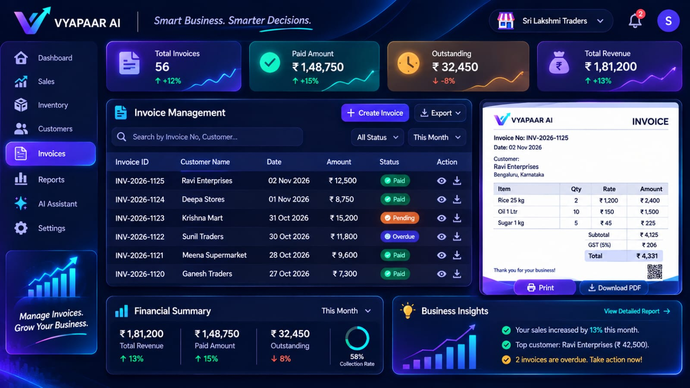
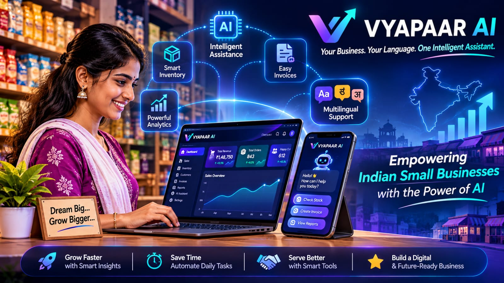

# VYAPAAR AI

**Your Business. Your Language. One Intelligent Assistant.**

VYAPAAR AI is an AI-powered business-management MVP designed to help small businesses manage inventory, invoices and business information through a multilingual interface.

## Features

- **Overview:** Business dashboard with clearly labelled sample figures.
- **AI Assistant:** Gemini-powered business question answering using locally stored inventory and invoice context.
- **Inventory:** Add, edit, search and manage products and stock status.
- **Invoices:** Create and manage invoices, with paid and outstanding summaries.
- **Insights:** Business summaries derived from available local records.
- **Multilingual interface:** English, Kannada and Hindi.

## Technology Stack

- Next.js
- React
- TypeScript
- Google Gemini API (`@google/genai`)
- Browser localStorage

## Getting Started

### Requirements

- Node.js and npm
- A Google Gemini API key

### Installation

```bash
git clone https://github.com/snehassneha4578-collab/vyapaar-ai.git
cd vyapaar-ai
npm install
```

### Environment Configuration

Create a `.env.local` file in the project root:

```env
GEMINI_API_KEY=your_gemini_api_key
```

Keep your actual API key private. Never commit `.env.local` or publish credentials.

### Run Locally

```bash
npm run dev
```

Open [http://localhost:3000](http://localhost:3000).

### Production Build

```bash
npm run build
```

## Data and Functionality Notes

- Inventory and invoice records are currently stored in the browser using localStorage.
- Data is local to the browser and is not yet backed by a shared cloud database.
- The AI assistant provides answers based on the available business context; it does not directly modify inventory or invoice records.
- Dashboard sample figures are demonstration data, not verified live business revenue or orders.
- Insights are derived from available local records; advanced predictive analytics are not yet implemented.

## Current Project Status

This repository represents the implemented VYAPAAR AI MVP. A complete commercial business platform is still under development.

Potential future improvements include cloud database integration, authentication, business data isolation, advanced analytics, automated alerts, PDF invoice workflows and production security hardening.

## Security

- Keep API keys and secrets in environment variables.
- Do not commit `.env.local`, private credentials, or local backup folders.
- Production deployment should include appropriate API authentication, rate limiting and security controls.

## License

No open-source license has been specified yet. All rights are reserved by default unless a license is added.

## Product Screenshots

### Main Dashboard


### AI Business Assistant


### Smart Inventory Management


### Invoices and Business Insights


### Product Vision

